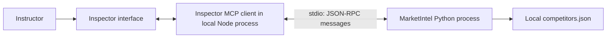

# MarketIntel: a local MCP classroom demo

MarketIntel exposes a small fictional competitor dataset through three tools,
two resources and two prompt templates. Everything in the server runs locally:
Python reads JSON and compares literal values. No API keys, paid services,
cloud accounts, LLMs, authentication or external databases are involved.

**Setup status, 2026-11-18:** source files and tests are implemented. A Python
3.12.12 virtual environment with pip is present. Dependency installation was
blocked by the execution environment's network restrictions. FastMCP tests and
Inspector integration have **not passed or been verified**. The installed Node
22.12.0 also needs an upgrade for current Inspector. Complete the setup and
verification below before presenting this as a working live demo.

## Run the scripts in VS Code on Windows

These instructions use **PowerShell in VS Code's integrated terminal**. The same
commands work in a PowerShell tab in the separate Windows Terminal app. Run each
command in order and wait for it to finish before continuing.

### 1. Open the folder and terminal

1. In VS Code, select **File > Open Folder** and open
   `C:\dev\SIMPLI\07\market-intel-mcp`.
2. Select **Terminal > New Terminal**.
3. In the terminal panel, use the dropdown next to **+** to select **PowerShell**
   if it is not already selected. See the
   [VS Code terminal guide](https://code.visualstudio.com/docs/terminal/basics).
4. Paste this command into the terminal and press Enter:

   ```powershell
   Set-Location 'C:\dev\SIMPLI\07\market-intel-mcp'
   ```

Paste only the commands inside the code blocks, without the surrounding Markdown
backticks. If you copied this project elsewhere, substitute your folder path.

### 2. Install the Python dependencies once

This computer already has `.venv`. Check its Python, then install the packages:

```powershell
.\.venv\Scripts\python.exe --version
.\.venv\Scripts\python.exe -m pip install -r requirements.txt
```

The install needs internet access. Wait for it to complete successfully. Repeat
it if `requirements.txt` changes or you recreate `.venv`.

For a fresh copy where `.venv` is missing, install Python 3.11 or newer, run
`python -m venv .venv` from the project folder, then run the two commands above.
If Windows recognizes `py` instead of `python`, use `py -3 -m venv .venv` with a
Python 3.11+ installation. All subsequent commands use the environment's exact
Python path, so activation and execution-policy changes are unnecessary.

### 3. Run the tests

Run the test suite with pytest:

```powershell
.\.venv\Scripts\python.exe -m pytest -v
```

A successful run should end with **21 passed** and return to the PowerShell
prompt. To run just the test that starts the real server over stdio:

```powershell
.\.venv\Scripts\python.exe -m pytest -v tests/test_server.py::test_real_stdio_from_another_directory
```

Run `tests/test_server.py` through pytest as shown; it contains tests that pytest
must discover and execute. You do not need to start `server.py` beforehand.

### 4. Launch the interactive demo

Inspector provides a browser interface for calling this server's tools. First
check Node and npm:

```powershell
node --version
npm.cmd --version
```

The installed Node 22.12.0 needs an update for Inspector 2.15.0. Install Node
**24.22.1 or newer within the 24.x line**, including npm, from
[Node.js](https://nodejs.org/en/download), then fully close and reopen VS Code.
This version range meets the
[Inspector package requirements](https://github.com/modelcontextprotocol/inspector/blob/main/package.json).
Open a new PowerShell terminal, return to the project folder, and check the
versions again.

After the Python dependencies and compatible Node version are installed, run:

```powershell
npx.cmd @modelcontextprotocol/inspector@2.15.0 --web 'C:\dev\SIMPLI\07\market-intel-mcp\.venv\Scripts\python.exe' 'C:\dev\SIMPLI\07\market-intel-mcp\server.py'
```

Accept npm's installation prompt if shown. The initial launch downloads Inspector.
Keep this terminal running; Inspector starts the Python server for you.

1. Open the complete browser URL printed in the terminal.
2. Connect to the configured server using **STDIO**. If the interface asks for
   connection details, use the Python executable path above as **Command** and
   the `server.py` path as its single **Argument**.
3. Open **Tools**, select `get_competitor`, enter `NimbusNoodle Support` for
   `name`, and execute. You should receive that company's fictional profile.
4. When finished, disconnect in Inspector, then click the terminal and press
   **Ctrl+C** to stop Inspector. If Windows asks to terminate the batch job,
   enter `Y`.

For resources, prompts, and comparisons, continue with the
[full Inspector walkthrough](#mcp-inspector-interactive-walkthrough).

### 5. Call tools directly from the terminal (optional)

After completing setup, you can use Inspector's CLI to print results directly.
If the browser demo is still running, open another PowerShell terminal using
the **+** button. Paste these path assignments into that terminal first:

```powershell
$pythonPath = 'C:\dev\SIMPLI\07\market-intel-mcp\.venv\Scripts\python.exe'
$serverPath = 'C:\dev\SIMPLI\07\market-intel-mcp\server.py'
```

List the three tools, then look up a company:

```powershell
npx.cmd --yes @modelcontextprotocol/inspector@2.15.0 --cli $pythonPath $serverPath --method tools/list
npx.cmd --yes @modelcontextprotocol/inspector@2.15.0 --cli $pythonPath $serverPath --method tools/call --tool-name get_competitor --tool-arg 'name=NimbusNoodle Support'
```

Each command starts its own server, prints the result, and exits. The variables
last only for that terminal session. See the
[Inspector CLI guide](https://github.com/modelcontextprotocol/inspector/blob/main/clients/cli/README.md)
and the [additional verification commands](#noninteractive-verification) below.

### 6. Run the Python server by itself (optional)

From the project folder:

```powershell
.\.venv\Scripts\python.exe .\server.py
```

The server waits for an MCP client to send protocol messages over standard
input/output. A quiet terminal is expected; this command does not open a browser
or accept typed company names. Press **Ctrl+C** to stop it. Use step 4 or 5 to
interact with it.

### Common terminal problems

| What you see | What to do |
| --- | --- |
| `.\.venv\Scripts\python.exe` is not recognized | Run the `Set-Location` command in step 1. If `.venv` is missing, create it as described in step 2. |
| `No module named fastmcp` or `No module named pytest` | Run the dependency-install command in step 2 and check that it succeeds. |
| `npx.ps1 cannot be loaded` or scripts are disabled | Use `npx.cmd` as shown here and call `.venv\Scripts\python.exe` directly. |
| `node` or `npm.cmd` is not recognized | Install Node with npm, then fully close and reopen VS Code. |
| `EBADENGINE` | Check `node --version` and update Node as described in step 4. |
| Downloads fail or npm reports `ENOTCACHED` | Complete the initial installation with network access to PyPI and npm. An offline launch requires packages already in the cache. |
| The terminal stays busy after starting Inspector or `server.py` | This is expected while a server is running. Use another terminal for other commands, or press Ctrl+C to stop it. |

## Files

```text
market-intel-mcp/
├── server.py
├── requirements.txt
├── README.md
├── data/
│   └── competitors.json
└── tests/
    └── test_server.py
```

`.venv/` holds the local Python environment. `.gitignore` excludes it and
generated caches. No frontend or dashboard is part of this project; Inspector
is a separate developer tool.

## Setup on this Windows computer

Use a normal PowerShell terminal with package-download access. The server and
tests need Python **3.11 or newer**. Python 3.12.12 is already available here.
For Inspector 2.15.0, install Node **24.22.1 or later within the 24.x release
line**, including npm/npx, from [Node.js](https://nodejs.org/en/download).
The [Inspector package manifest](https://github.com/modelcontextprotocol/inspector/blob/main/package.json)
also lists the supported 22.x and 26.x versions. Open a new terminal after a
Node upgrade and check `node --version`.

On this computer, `.venv` and pip already exist. Install the project dependencies:

```powershell
Set-Location 'C:\dev\SIMPLI\07\market-intel-mcp'
.\.venv\Scripts\python.exe -m pip install -r requirements.txt
.\.venv\Scripts\python.exe -m pytest -q
```

For a fresh copy on another Windows computer, first create the environment:

```powershell
python --version
python -m venv .venv
.\.venv\Scripts\python.exe -m pip install -r requirements.txt
.\.venv\Scripts\python.exe -m pytest -q
```

Activation is optional: every command explicitly selects the venv interpreter.
If desired, use `.\.venv\Scripts\Activate.ps1`. There is no need to change
PowerShell's execution policy to run the commands above. If your shell blocks
`npx.ps1`, use `npx.cmd` with the same arguments.

On macOS/Linux, from the project directory:

```bash
python3 -m venv .venv
.venv/bin/python -m pip install -r requirements.txt
.venv/bin/python -m pytest -q
npx @modelcontextprotocol/inspector "$(pwd)/.venv/bin/python" "$(pwd)/server.py"
```

Dependencies are pinned to FastMCP 4.2.1, pytest 9.2.0 and pytest-asyncio 1.5.0.
These versions were checked against the package publishers on 2026-11-18; they
have not yet been installed together here. Transitive dependencies are resolved
by pip. The application uses the standalone `fastmcp` package and imports
`FastMCP` from `fastmcp`.

**Before class:** install Python packages and launch Inspector once while online.
Initial installation needs downloads; the server itself has no runtime network
dependency. Keep the same npm cache for an offline classroom session, and
rehearse an offline launch before relying on it:

```powershell
npx --offline @modelcontextprotocol/inspector@2.15.0 'C:\dev\SIMPLI\07\market-intel-mcp\.venv\Scripts\python.exe' 'C:\dev\SIMPLI\07\market-intel-mcp\server.py'
```

That offline command requires a successful prior download of that exact version.

## Architecture to explain

An **MCP server** is a program that advertises capabilities and handles protocol
requests. It need not be a website, remote service or AI model. Here it is the
Python process executing `server.py`.

A **host** is the application coordinating the experience and deciding what data
and operations to expose to the user or a model. An **MCP client** is its protocol
connection to a server. A host can manage several such connections. In this
exercise Inspector supplies the interface and client; the instructor chooses the
requests manually. No model is required.



The client starts Python with pipes, establishes an MCP connection and discovers
available capabilities. A tool call includes the tool name and arguments.
FastMCP validates those arguments, runs the registered function and serializes
its result. The client can independently read a resource or retrieve a prompt.
Disconnecting ends the client's server session. Inspector's browser interface
talks to its local Node process; **MarketIntel communicates over stdio**, not HTTP.
See the [FastMCP transport documentation](https://gofastmcp.com/docs/clients/transports).

| Element | What it exposes | Registration | Discovery and use | Classroom example |
| --- | --- | --- | --- | --- |
| Tool | An operation with typed inputs and results | `@mcp.tool` | `tools/list`, `tools/call` | Look up or compare profiles |
| Resource | Contextual content addressed by a URI | `@mcp.resource(...)` | `resources/list`, `resources/read` | Read the dataset's limitations |
| Prompt | A reusable message template with arguments | `@mcp.prompt` | `prompts/list`, `prompts/get` | Retrieve analysis instructions |

Tools are typically selected by models through their host; resources are managed
as context by applications; prompts are often selected by users. Inspector lets
us exercise all three manually. Tools can be read-only, as all ours are. Resource
and prompt functions can run Python to assemble their returned content. A prompt
request here only creates text: **registration and retrieval never execute an
LLM or automatically call the tools named in the template**.

Decorators register capabilities when Python loads the module. FastMCP uses
function names, type hints and docstrings to describe them to clients. The
`if __name__ == "__main__"` guard starts stdio only when the file is executed,
so tests can safely import the server. The three current decorator APIs are
documented under [tools](https://gofastmcp.com/docs/servers/tools),
[resources](https://gofastmcp.com/docs/servers/resources), and
[prompts](https://gofastmcp.com/docs/servers/prompts).

## Dataset and predictable behavior

All four companies and their attributes are invented teaching examples:

- NimbusNoodle Support — small retailers.
- PixelPuff Assist — small retailers.
- WobbleWidget Care — software teams.
- MoonMuffin Help — appointment-based services.

Every website uses `.example`; the server never fetches any website. The JSON
contains `name`, `market`, `strengths`, `weaknesses` and `website` for each company.

`get_competitor` accepts a full name, ignores case and surrounding whitespace,
and returns the five fields. Partial names and blank names fail clearly.
`list_competitors` returns the four names in alphabetical order.
`compare_competitors` returns both full profiles, `same_market`, sorted
`shared_strengths`, sorted `shared_weaknesses` and a limitations notice. Shared
items use exact string equality. It does not rank companies or infer synonyms.
Comparing a company with itself is allowed. If either or both names are missing,
the error names every missing input and suggests `list_competitors`.

For NimbusNoodle Support versus PixelPuff Assist, expect:

```json
{
  "same_market": true,
  "shared_strengths": ["Human handoff"],
  "shared_weaknesses": ["No voice support"]
}
```

This excerpt omits the two full profiles and limitations field for readability.
These are comparisons of fictional statements, not verified business findings.

## MCP Inspector: interactive walkthrough

The [official Inspector guide](https://modelcontextprotocol.io/docs/2026-07-28/tools/inspector/web)
describes the current interface. This project targets Inspector **2.15.0**;
button wording may vary in later versions.

1. Start Inspector from PowerShell:

   ```powershell
   npx @modelcontextprotocol/inspector
   ```

   Accept npm's package-install prompt if it appears. Open the URL printed in
   the terminal. Keep that terminal running. The printed URL includes Inspector's
   local session token; keep its default protection enabled. That token belongs
   to Inspector's own interface, not authentication added to MarketIntel.

2. In **Servers**, add a local server named `MarketIntel` with transport **STDIO**.
   Supply these values:

   | Field | Value |
   | --- | --- |
   | Command | `C:\dev\SIMPLI\07\market-intel-mcp\.venv\Scripts\python.exe` |
   | Arguments | `C:\dev\SIMPLI\07\market-intel-mcp\server.py` |
   | Environment variables | None required |
   | Protocol era, if shown | Auto |

   The arguments field contains one argument: the absolute server path. If the
   interface uses an argument list, add one entry. Save and connect. Do not start
   a separate Python server first: Inspector owns the child process.

   Alternatively, preconfigure the command and argument directly:

   ```powershell
   npx @modelcontextprotocol/inspector 'C:\dev\SIMPLI\07\market-intel-mcp\.venv\Scripts\python.exe' 'C:\dev\SIMPLI\07\market-intel-mcp\server.py'
   ```

   For the exact documented Inspector release, replace the package name with
   `@modelcontextprotocol/inspector@2.15.0`.

3. Open **Tools**. Discover/refresh the list if it has not loaded automatically.
   Expect `get_competitor`, `list_competitors` and `compare_competitors`. Inspect
   `get_competitor`'s schema: `name` is a required string. Discovery does not call
   the tool.

4. Select `get_competitor`, enter `NimbusNoodle Support` for `name`, and execute.
   Inspect the structured JSON and text content. The returned profile should
   match `data/competitors.json`. Try `list_competitors` without arguments, then
   compare NimbusNoodle Support with PixelPuff Assist.

5. Open **Resources** and select/read `market://overview`. Identify its purpose
   and fictional-data limitations. Read `market://competitors` to see the
   complete indented JSON dataset. These URIs are MCP identifiers, not browser
   links or network locations.

6. Open **Prompts**, select `competitor_analysis`, enter `NimbusNoodle Support`
   for `name`, and retrieve/render the prompt. Inspect the returned user message:
   it asks for evidence-aware analysis and labels fictional data. It is not a
   completed analysis. Also retrieve `market_summary` with industry
   `AI customer support` to see opportunities and risks instructions.

7. Call `get_competitor` with `Missing Company`. Inspect the error result:
   `isError: true` with a message beginning `Competitor not found`. This is a
   failed tool operation returned through MCP, not a broken connection. Correct
   the name and call again. The **Protocol** view shows requests and responses;
   the **Console** view shows process stderr. Disconnect and press Ctrl+C in
   the Inspector terminal when finished.

## Noninteractive verification

The tests use the documented [FastMCP testing approach](https://gofastmcp.com/docs/servers/testing):
`async with Client(mcp)` exercises actual discovery, calls, reads and prompt
retrieval in memory. The final test uses `StdioTransport` and the venv's
`sys.executable` to launch `server.py` from a different working directory.
This separately checks the real process/pipe boundary and absolute data path.
No fake FastMCP implementation or private registry APIs are used.

```powershell
Set-Location 'C:\dev\SIMPLI\07\market-intel-mcp'
.\.venv\Scripts\python.exe -m pytest -v
```

The suite contains 21 test cases, including parameterized cases. It covers
quiet import, discoverable argument schemas, complete profiles, name
normalization, unknown inputs, required arguments, deterministic comparisons,
both missing comparison inputs, readable resources, retrievable prompts and
the subprocess stdio connection. A successful pytest run does not by itself
verify the Inspector interface.

Use Inspector's actual [CLI client](https://github.com/modelcontextprotocol/inspector/blob/main/clients/cli/README.md)
for a separate interoperability check. In PowerShell:

```powershell
$pythonPath = 'C:\dev\SIMPLI\07\market-intel-mcp\.venv\Scripts\python.exe'
$serverPath = 'C:\dev\SIMPLI\07\market-intel-mcp\server.py'

npx --yes @modelcontextprotocol/inspector@2.15.0 --cli $pythonPath $serverPath --method tools/list
npx --yes @modelcontextprotocol/inspector@2.15.0 --cli $pythonPath $serverPath --method tools/call --tool-name get_competitor --tool-arg 'name=NimbusNoodle Support'
npx --yes @modelcontextprotocol/inspector@2.15.0 --cli $pythonPath $serverPath --method tools/call --tool-name compare_competitors --tool-arg 'name1=NimbusNoodle Support' --tool-arg 'name2=PixelPuff Assist'
npx --yes @modelcontextprotocol/inspector@2.15.0 --cli $pythonPath $serverPath --method resources/list
npx --yes @modelcontextprotocol/inspector@2.15.0 --cli $pythonPath $serverPath --method resources/read --uri market://overview
npx --yes @modelcontextprotocol/inspector@2.15.0 --cli $pythonPath $serverPath --method resources/read --uri market://competitors
npx --yes @modelcontextprotocol/inspector@2.15.0 --cli $pythonPath $serverPath --method prompts/list
npx --yes @modelcontextprotocol/inspector@2.15.0 --cli $pythonPath $serverPath --method prompts/get --prompt-name competitor_analysis --prompt-args 'name=NimbusNoodle Support'
npx --yes @modelcontextprotocol/inspector@2.15.0 --cli $pythonPath $serverPath --method prompts/get --prompt-name market_summary --prompt-args 'industry=AI customer support'
npx --yes @modelcontextprotocol/inspector@2.15.0 --cli $pythonPath $serverPath --method tools/call --tool-name get_competitor --tool-arg 'name=Missing Company'
```

Each CLI invocation starts and closes its own server process. Successful
commands should produce the requested capabilities/content and exit zero.
The final command deliberately produces a tool error; inspect its message and
expect Inspector to report failure. Check `$LASTEXITCODE` immediately after a
command when investigating a failure.

## Fifteen-minute instructor walkthrough

| Time | Instructor action | Student takeaway |
| --- | --- | --- |
| 0–3 | Draw host → client → server → JSON. Show the Python file and identify Inspector's client. Explain the local stdio pipes. | MCP is a communication protocol; the server is a process, and no LLM is required to exercise it. |
| 3–5 | Point to `FastMCP("MarketIntel")` and the three decorator types. Show a docstring, `name: str`, a resource URI and the main guard. | Decorators register capabilities; names, schemas and descriptions enable discovery. |
| 5–8 | Discover tools, inspect the `name` schema, call `get_competitor`, then try `Missing Company`. Optionally compare two profiles. | Discovery describes an operation; execution runs it. Errors are structured responses the client can handle. |
| 8–10 | Read `market://overview`, then `market://competitors`. Ask which limitations matter. | A resource supplies context by URI; retrieving data does not establish that it is true. |
| 10–12 | Retrieve `competitor_analysis` for NimbusNoodle Support and highlight the evidence/assumption distinction. | A prompt is reusable instructions, not an LLM result or an automatically executed workflow. |
| 12–15 | Discuss a hypothetical write tool, host approval rules, narrow file access and trusting data sources. Suggest an internal documentation lookup or inventory comparison. | Permission policy belongs in the host/server design; MCP registration alone grants no safety guarantees. |

Five discussion questions, with no coding required:

1. When the instructor presses Execute, which part is the host/interface, which
   part is the MCP client, and which part runs the Python function?
2. How is discovering `get_competitor` different from calling it, and what does
   its input schema tell the client?
3. Why is `market://overview` useful as a resource even though a read-only tool
   could also return text?
4. Why does retrieving `competitor_analysis` not produce an analysis? What must
   happen later if a host wants an AI-generated response?
5. If we added a tool that changes customer records, what permissions and
   confirmation rules would you want? Why are fictional data and source labels
   still useful in this read-only demo?

## Safety and troubleshooting

The only data path is fixed relative to `server.py`; names cannot select files,
commands or URLs. There are no write tools or network requests. The local child
process still runs with the launching user's OS permissions: stdio is not a
sandbox. A production host should restrict available tools and require suitable
approval for consequential operations. This demo adds no server authentication.

**Keep stdout clean.** MCP owns the server's standard output. Application logging
is explicitly directed to stderr, and the FastMCP startup banner is suppressed.
If adding diagnostics, use `logging` or `print(..., file=sys.stderr)`. The absence
of normal terminal output is expected. Running the server alone is possible:

```powershell
.\.venv\Scripts\python.exe .\server.py
```

It waits for protocol messages, not typed company names; stop with Ctrl+C and
use Inspector for the demonstration.

| Symptom | Action |
| --- | --- |
| `No module named fastmcp` or `pytest` | Install `requirements.txt` with this project's venv Python. |
| npm `ENOTCACHED`, `ECONNREFUSED` or pip cannot find packages offline | Complete setup in a terminal permitted to reach npm/PyPI, or supply downloaded dependencies. This session cannot download packages. |
| `EBADENGINE` or Inspector exits on startup | Upgrade Node to a version supported by the pinned Inspector package; reopen the terminal. |
| `spawn ENOENT` | Check both absolute Inspector paths; the command must be the venv Python executable. |
| JSON/protocol parsing errors | Remove stdout diagnostics; inspect server stderr in Console. |
| Inspector interface cannot connect | Open the complete URL printed by Inspector, including its local session token, and check that its terminal is still running. |
| Dataset edit is not visible | Tools/resources read the JSON on each request. For Python/decorator edits, disconnect and reconnect to restart the process. |

## Verification record and remaining manual checks

The implementation was prepared on 2026-11-18 on Windows with Python 3.12.12,
Node 22.12.0 and npm 10.9.0. Virtual-environment creation initially failed during
`ensurepip` because of temporary-directory permissions. Pip was subsequently
installed into `.venv` from an existing local cached wheel using uv. The Python
environment itself is usable.

Package installation through uv could not reach PyPI (connection refused by the
restricted environment). npm likewise could not reach the package registry;
Inspector was not present in its cache. These are setup failures, not passing
integration tests. Python source compilation and JSON inspection can check
syntax/data only; they cannot verify FastMCP registration or interoperability.

| Check actually executed | Result |
| --- | --- |
| Venv Python and pip version commands | Python 3.12.12 and pip 26.3 available in `.venv` |
| `python -m compileall -q server.py tests` | Passed |
| JSON shape, four unique names, `.example` domains, function docstrings and return annotations | Passed static checks |
| `uv pip install ... --offline -r requirements.txt` | Blocked: FastMCP 4.2.1 absent from cache |
| `.venv\Scripts\python.exe -m pytest -q` | Could not start: `No module named pytest`; zero tests executed |
| Inspector 2.15.0 CLI `tools/list` via `npx --offline` | Could not start: npm `ENOTCACHED`; no server connection made |

The browser walkthrough has not been manually verified.

Before class, finish all of these:

- [ ] Install dependencies and obtain a passing run of all pytest cases.
- [ ] Upgrade Node and successfully run the Inspector CLI checks above.
- [ ] Launch Inspector's browser UI and connect with the exact absolute paths.
- [ ] Discover three tools, read both resources and retrieve both prompts.
- [ ] Demonstrate a successful lookup and a clear unknown-company error.
- [ ] Rehearse the 15-minute sequence and, if necessary, the cached offline launch.

Until these checks are completed, this project is **implemented but not yet
verified ready for a live demonstration**.
